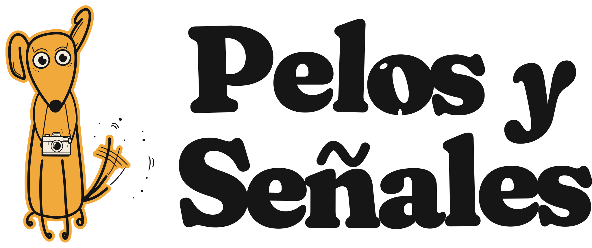
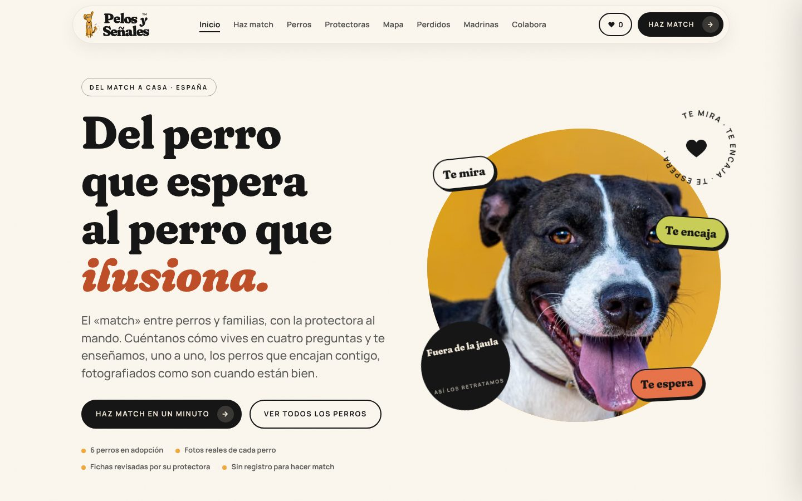
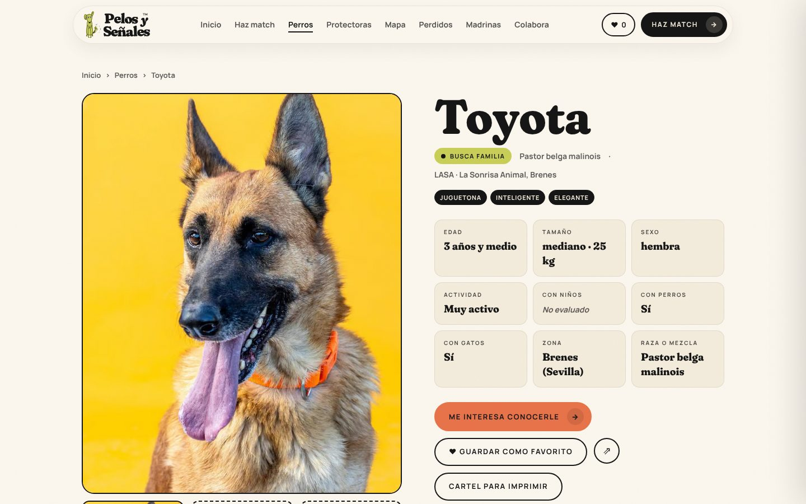
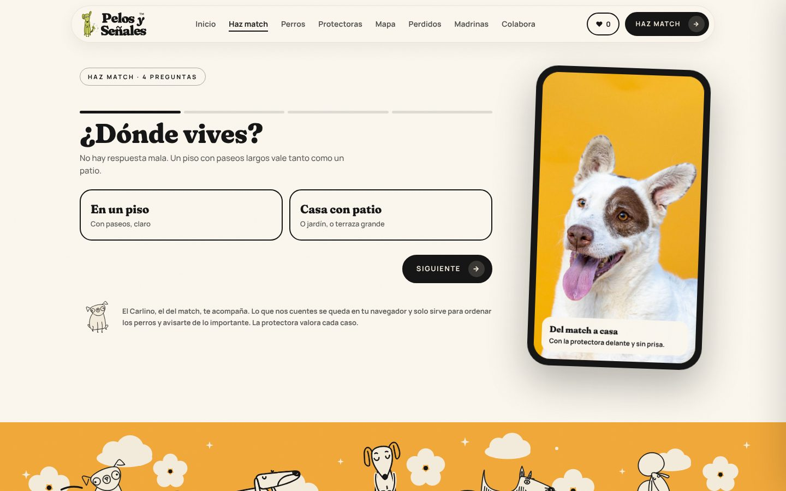
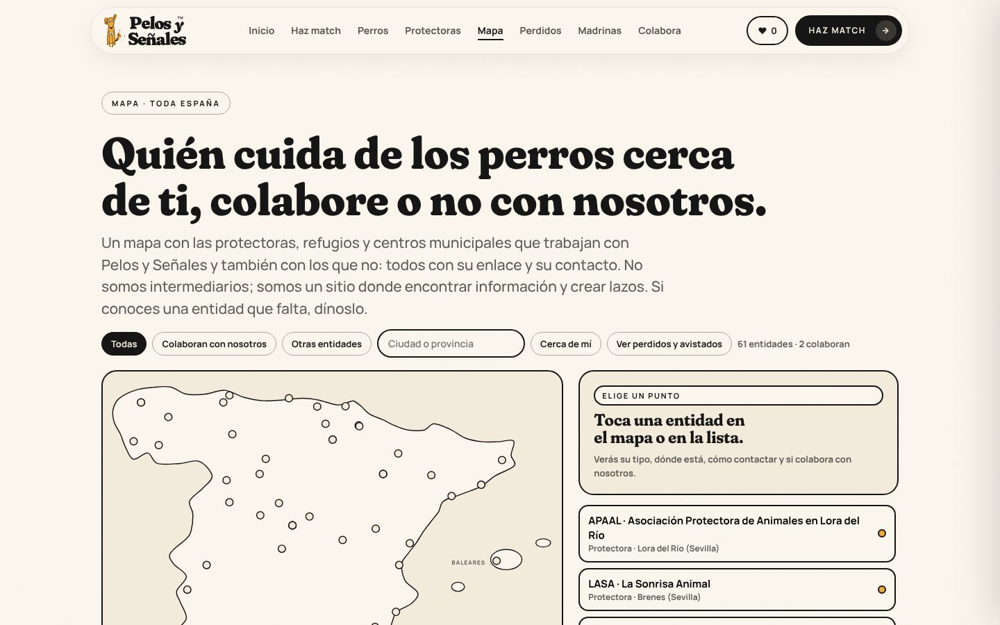
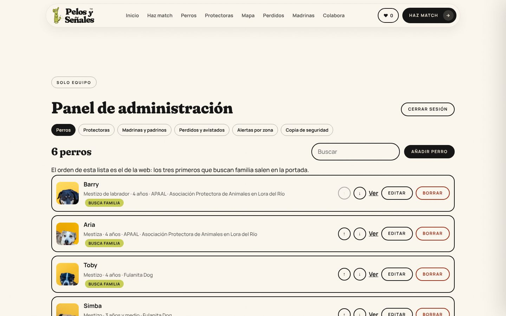

<p align="center">
  
</p>

<p align="center"><strong>Del match a casa.</strong> Fotos que encuentran familia a los perros de las protectoras.</p>

<p align="center">
  <a href="https://xn--pelosyseales-hhb.com">pelosyseñales.com</a> ·
  <a href="https://www.instagram.com/pelosysenales.es/">@pelosysenales.es</a>
</p>

---

Pelos y Señales fotografía a los perros de protectoras y refugios de España como son cuando están bien: fuera de la jaula, jugando, sobre un fondo de color. Cada perro tiene su ficha revisada por su protectora, y quien quiere adoptar hace match con los que encajan con su vida y escribe directamente a la protectora, que es quien decide.

Esta es la web del proyecto: catálogo de perros con match por estilo de vida, mapa de protectoras de toda España, tablón de perros perdidos y avistados, y un panel para que el equipo lo gestione todo sin tocar código.

<p align="center">
  
  
</p>

## Qué hace

| | |
| --- | --- |
| **Fichas de perros** | Foto de estudio, datos, convivencia con niños, perros y gatos («sin probar» cuando la protectora no lo sabe), carácter, qué casa le iría bien y formulario de consulta que llega a su protectora. |
| **Haz match** | Cuatro preguntas sobre cómo vives que ordenan los perros por afinidad y explican con palabras por qué encaja cada uno. Sin registro. |
| **Descubrir** | Baraja para pasar perros uno a uno y guardar favoritos, con teclado o arrastrando. |
| **Mapa** | Protectoras que colaboran y un directorio de 59 entidades reales de toda España, con la fuente de cada dato. |
| **Perdidos y avistados** | Avisos con foto y ubicación en el mapa, publicados tras confirmar el correo; cruce automático de posibles coincidencias y alertas por zona (30 km). |
| **Panel de administración** | `/admin`: alta, edición y borrado de perros, protectoras y madrinas con subida de fotos; moderación de avisos; alertas; copia de seguridad. |

<p align="center">
  
  
  
</p>

## Tecnología

- **[Next.js 16](https://nextjs.org/)** (App Router, componentes de servidor, `proxy.ts`), **React 19** y **TypeScript**.
- Diseño propio sin librerías de componentes: tokens de la marca en `app/globals.css`, tipografías autoalojadas (Fraunces Soft, Manrope y Caveat).
- **Upstash Redis** por API REST para el catálogo editable, los avisos y el límite de peticiones.
- **Resend** para los correos (consultas, confirmaciones, alertas), con dominio propio verificado.
- Desplegada en **Vercel**.

## Calidad

- **Accesibilidad:** auditoría con axe-core (WCAG 2.1 A/AA) en todas las rutas a 1280 y 390 px, sin incidencias.
- **Seguridad:** cabeceras CSP, HSTS y Permissions-Policy; enlaces firmados con HMAC; límite de peticiones por IP; campos cebo contra bots; sesión de administración con cookie firmada, `httpOnly` y `SameSite=Strict`.
- **Privacidad:** los correos de quien publica un aviso nunca se muestran; las consultas solo llegan a la protectora del perro.
- **SEO:** sitemap y metadatos generados desde el catálogo, Open Graph por ficha.

## Estructura

```
app/                 páginas y rutas de la API
  admin/             panel de administración
  api/               consultas, contacto, avisos, alertas, panel e imágenes
  perros/ protectoras/ madrinas/ mapa/ perdidos/ match/ descubrir/
components/          piezas de la interfaz (fichas, mapa, baraja, formularios, panel)
lib/
  catalog.ts         catálogo editable (Upstash), con caché e invalidación al guardar
  data.ts            tipos y datos iniciales de perros y protectoras
  avisos-server.ts   perdidos y avistados: publicar, moderar, caducar, alertas por zona
  admin.ts           acceso al panel
  mail.ts, kv.ts, guard.ts
public/brand/        logotipos e ilustraciones de la pandilla
public/img/lasa/     fotos de la primera sesión
docs/                capturas y guía de fotografía
scripts/             preparación de fotos para la web
```

## Arrancar en local

```bash
npm install
cp .env.example .env.local   # sin claves también funciona: correos simulados y datos en memoria
npm run dev                  # http://localhost:3000
```

Las variables están explicadas en [`.env.example`](.env.example). En producción hacen falta `ALERTAS_SECRET`, `ADMIN_PASSWORD`, las de Upstash (`KV_REST_API_URL`, `KV_REST_API_TOKEN`) y las de Resend (`RESEND_API_KEY`, `MAIL_FROM`).

## Fotografía

Todas las fotos siguen la misma guía para que la web tenga unidad: fondo liso en un color de la marca, retrato a la altura de los ojos y luz suave. Está en [`docs/guia-fotos.md`](docs/guia-fotos.md).

## Créditos y licencia

Proyecto de **María Leal**, fotógrafa (EME Fotografía Sevilla). Fotos de los perros publicadas con autorización de APAAL, La Sonrisa Animal y Fulanita Dog.

© 2026 Pelos y Señales. Todos los derechos reservados. El código se publica para consulta; la marca Pelos y Señales™ (solicitud OEPM M4412157), el logotipo y las fotografías no se pueden reutilizar sin permiso. Las ilustraciones de la pandilla parten de un set de Vecteezy con su licencia y atribución.
